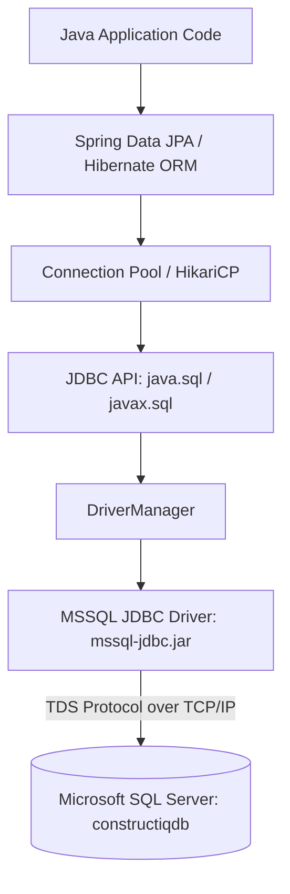

# Java & SQL Database Connectivity (JDBC & Spring Data JPA)
## Comprehensive Architecture, Implementation & Practical Guide

---

## 1. Introduction: What is SQL-Java Connectivity?

**SQL-Java Connectivity** refers to the technology and protocols that allow Java applications to interact with relational databases (such as Microsoft SQL Server, MySQL, PostgreSQL, or Oracle). Through this connectivity, Java programs can:
* Establish a secure communication channel with the database server.
* Send Structured Query Language (**SQL**) statements (`SELECT`, `INSERT`, `UPDATE`, `DELETE`, DDL).
* Retrieve tabular query results and map them into Java objects and memory structures.
* Manage transactions (Commit, Rollback, Savepoints).

In modern Java development, SQL connectivity is achieved at two primary levels:
1. **Low-Level (Core JDBC):** The fundamental standard API (`java.sql.*`) provided by the Java SE platform.
2. **High-Level (ORM & Spring Data JPA):** Enterprise abstraction frameworks (such as Hibernate and Spring Boot Data JPA) built on top of JDBC, which automate object-relational mapping and connection management.

---

## 2. The Core Architecture of JDBC

Java Database Connectivity (**JDBC**) acts as a bridge between Java applications and diverse database engines.



### The 4 Major JDBC Components

1. **JDBC API (`java.sql` and `javax.sql` packages):**
   Standard Java interfaces defining how to interact with databases:
   * `Connection`: Represents an active physical connection session with the database.
   * `Statement` & `PreparedStatement`: Encapsulate SQL statements sent to the database.
   * `ResultSet`: Represents the tabular data returned by a `SELECT` query.
   * `DataSource`: An enterprise alternative to `DriverManager` supporting connection pooling.

2. **JDBC Driver Manager (`DriverManager`):**
   The management layer that tracks available database drivers and establishes database connections matching a specific connection URL.

3. **JDBC Driver (Vendor-Specific Implementation):**
   A library provided by the database vendor (for example, Microsoft provides `mssql-jdbc`) that translates generic JDBC method calls into the proprietary network wire protocol of that database (e.g., TDS - Tabular Data Stream protocol for MS SQL Server).

4. **Database Engine:**
   The relational database server (e.g., Microsoft SQL Server `SQLEXPRESS` hosting `constructiqdb`) executing SQL queries and managing storage, locks, and indexing.

---

## 3. The 5 Fundamental Steps of Core JDBC

When working with pure Java without frameworks, database connectivity follows 5 standard steps:

```
[1. Load Driver] ➔ [2. Open Connection] ➔ [3. Create Statement] ➔ [4. Execute Query] ➔ [5. Process & Close]
```

### Complete Pure JDBC Code Example (MS SQL Server)

```java
package com.constructiq.example;

import java.sql.Connection;
import java.sql.DriverManager;
import java.sql.PreparedStatement;
import java.sql.ResultSet;
import java.sql.SQLException;

public class RawJdbcConnectivityDemo {

    // 1. Connection Parameters
    private static final String DB_URL = "jdbc:sqlserver://localhost;instanceName=SQLEXPRESS;databaseName=constructiqdb;encrypt=true;trustServerCertificate=true";
    private static final String USERNAME = "sa";
    private static final String PASSWORD = "password";

    public static void main(String[] args) {
        // SQL query with a parameterized placeholder (?) to prevent SQL Injection
        String sqlQuery = "SELECT id, name, email, role FROM users WHERE role = ?";

        // 2 & 5. Use try-with-resources to automatically close Connection, Statement, and ResultSet
        try (
            // Step 1 & 2: Establish connection via DriverManager
            Connection connection = DriverManager.getConnection(DB_URL, USERNAME, PASSWORD);

            // Step 3: Create PreparedStatement (pre-compiled SQL)
            PreparedStatement preparedStatement = connection.prepareStatement(sqlQuery)
        ) {
            System.out.println(" Successfully connected to Microsoft SQL Server!");

            // Bind value to parameter placeholder index 1
            preparedStatement.setString(1, "admin");

            // Step 4: Execute query and receive ResultSet
            try (ResultSet resultSet = preparedStatement.executeQuery()) {
                
                System.out.println("\n--- Query Results (Users with role 'admin') ---");
                // Step 5: Iterate through the cursor of records
                while (resultSet.next()) {
                    long id = resultSet.getLong("id");
                    String name = resultSet.getString("name");
                    String email = resultSet.getString("email");
                    String role = resultSet.getString("role");

                    System.out.printf("ID: %d | Name: %s | Email: %s | Role: %s%n",
                            id, name, email, role);
                }
            }

        } catch (SQLException e) {
            System.err.println("Database connection or query failure: " + e.getMessage());
            e.printStackTrace();
        }
    }
}
```

### Detailed Breakdown of Core JDBC Steps:

1. **Driver Loading:**
   Modern JDBC drivers (JDBC 4.0+) are loaded automatically via Java SPI (`ServiceLoader`), but under the hood, `com.microsoft.sqlserver.jdbc.SQLServerDriver` registers itself with `DriverManager`.
2. **`DriverManager.getConnection(...)`:**
   Opens a physical socket connection to SQL Server, verifies credentials (`sa` / `password`), and selects the database (`constructiqdb`).
3. **`PreparedStatement` vs `Statement`:**
   * Always use `PreparedStatement`. It pre-compiles the query and separates SQL instructions from user inputs, completely immunizing the application against **SQL Injection attacks**.
4. **`ResultSet` Navigation:**
   * `resultSet.next()` moves the internal row pointer forward one row. Returns `true` if a row exists, `false` when all rows are read.
5. **Resource Management:**
   * Database connections and cursors consume server memory and socket handles. Wrapping them in a Java `try-with-resources` block guarantees they are closed even if an exception occurs.

---

## 4. SQL-Java Connectivity in ConstructIQ (Spring Boot + JPA)

In enterprise applications like **ConstructIQ**, developers do not write repetitive low-level JDBC code. Instead, **Spring Data JPA** and **Hibernate** handle connection management, SQL generation, and result mapping automatically.

### Architecture Layering in ConstructIQ

```
┌────────────────────────────────────────────────────────┐
│  Client / Frontend (HTML / JS / REST Client)          │
└───────────────────────────┬────────────────────────────┘
                            │ HTTP JSON
┌───────────────────────────▼────────────────────────────┐
│  REST Controller Layer (e.g., UserController.java)     │
└───────────────────────────┬────────────────────────────┘
                            │ Method Invocation
┌───────────────────────────▼────────────────────────────┐
│  Repository Layer (e.g., UserRepository.java)          │
│  (Spring Data JPA dynamically implements queries)     │
└───────────────────────────┬────────────────────────────┘
                            │ Object-Relational Mapping (ORM)
┌───────────────────────────▼────────────────────────────┐
│  Hibernate Core & JPA Engine                           │
│  (Generates SQL: SELECT, INSERT, UPDATE, DELETE)       │
└───────────────────────────┬────────────────────────────┘
                            │ Pooled Connections
┌───────────────────────────▼────────────────────────────┐
│  HikariCP Connection Pool                              │
└───────────────────────────┬────────────────────────────┘
                            │ JDBC API calls
┌───────────────────────────▼────────────────────────────┐
│  Microsoft SQL Server JDBC Driver (mssql-jdbc)         │
└───────────────────────────┬────────────────────────────┘
                            │ TDS Protocol / TCP:1433
┌───────────────────────────▼────────────────────────────┐
│  Database Server: Microsoft SQL Server (SQLEXPRESS)    │
└────────────────────────────────────────────────────────┘
```

---

## 5. ConstructIQ Project Configuration Breakdown

### 5.1. Maven Dependencies (`pom.xml`)

In `ConstructIQ-Java/pom.xml`, two key dependencies enable SQL-Java connectivity:

```xml
<!-- 1. Spring Data JPA: Includes Hibernate, HikariCP, and JPA interfaces -->
<dependency>
    <groupId>org.springframework.boot</groupId>
    <artifactId>spring-boot-starter-data-jpa</artifactId>
</dependency>

<!-- 2. Microsoft SQL Server Official JDBC Driver -->
<dependency>
    <groupId>com.microsoft.sqlserver</groupId>
    <artifactId>mssql-jdbc</artifactId>
    <scope>runtime</scope>
</dependency>
```

* **`spring-boot-starter-data-jpa`**: Imports Hibernate (the ORM engine), HikariCP (high-performance connection pool), and the Spring Data transaction manager.
* **`mssql-jdbc`**: Microsoft's official driver communicating with SQL Server via TDS protocol.

---

### 5.2. Datasource Configuration (`application.properties`)

In `ConstructIQ-Java/src/main/resources/application.properties`:

```properties
# ── Microsoft SQL Server Connection String ──────────────────
spring.datasource.url=jdbc:sqlserver://localhost;instanceName=SQLEXPRESS;databaseName=constructiqdb;encrypt=true;trustServerCertificate=true
spring.datasource.driverClassName=com.microsoft.sqlserver.jdbc.SQLServerDriver
spring.datasource.username=sa
spring.datasource.password=password

# ── JPA / Hibernate Settings ───────────────────────────────
spring.jpa.database-platform=org.hibernate.dialect.SQLServer2012Dialect
spring.jpa.hibernate.ddl-auto=update
spring.jpa.show-sql=true
spring.jpa.properties.hibernate.format_sql=true
```

#### Parameter Explanation:

| Parameter | Purpose & Explanation |
|---|---|
| `jdbc:sqlserver://localhost` | Protocol identifier and database host. Connects locally. |
| `instanceName=SQLEXPRESS` | Specifies the named SQL Server instance (common for SQL Server Express installations). |
| `databaseName=constructiqdb` | The target database catalog containing the tables (`users`, `projects`, etc.). |
| `encrypt=true` | Forces Transport Layer Security (TLS) encryption for database traffic. |
| `trustServerCertificate=true` | Permits connection using local/self-signed SSL certificates without validation errors. |
| `driverClassName` | Fully qualified name of Microsoft's driver class. |
| `username` / `password` | Database credentials (`sa` = System Administrator). |
| `hibernate.ddl-auto=update` | Automatically inspects `@Entity` classes and executes `ALTER TABLE` / `CREATE TABLE` to sync schema changes without losing data. |
| `show-sql=true` & `format_sql=true` | Prints every executed SQL statement formatted to the application console for debugging. |

---

## 6. How Code Interacts with SQL in ConstructIQ

### Step 1: Mapping Java Objects to SQL Tables (`@Entity`)

File: `com.constructiq.model.User`

```java
@Entity
@Table(name = "users") // Maps this Java class to the 'users' table in SQL Server
public class User {

    @Id
    @GeneratedValue(strategy = GenerationType.IDENTITY) // SQL Server IDENTITY(1,1) auto-increment
    private Long id;

    @Column(nullable = false, length = 150)
    private String name;

    @Column(nullable = false, unique = true, length = 255)
    private String email;

    @Column(nullable = false, length = 50)
    private String role;

    // Getters and Setters...
}
```

**What Happens in SQL:**
Hibernate generates and executes:
```sql
CREATE TABLE users (
    id BIGINT IDENTITY(1,1) NOT NULL,
    name NVARCHAR(150) NOT NULL,
    email NVARCHAR(255) NOT NULL UNIQUE,
    role NVARCHAR(50) NOT NULL,
    PRIMARY KEY (id)
);
```

---

### Step 2: The Data Access Repository (`JpaRepository`)

File: `com.constructiq.repository.UserRepository`

```java
package com.constructiq.repository;

import com.constructiq.model.User;
import org.springframework.data.jpa.repository.JpaRepository;
import java.util.Optional;

public interface UserRepository extends JpaRepository<User, Long> {
    // Spring Data automatically converts this method signature into a SQL Query:
    Optional<User> findByEmail(String email);
}
```

* By extending `JpaRepository<User, Long>`, Spring Data JPA automatically provides ready-to-use methods:
  * `save(user)` ➔ `INSERT INTO users ...` or `UPDATE users ...`
  * `findById(id)` ➔ `SELECT * FROM users WHERE id = ?`
  * `findAll()` ➔ `SELECT * FROM users`
  * `delete(user)` ➔ `DELETE FROM users WHERE id = ?`
  * `findByEmail("admin@...")` ➔ `SELECT * FROM users WHERE email = ?`

---

### Step 3: Executing Database Operations (e.g., `DatabaseSeeder.java`)

File: `com.constructiq.DatabaseSeeder`

```java
@Component
public class DatabaseSeeder implements CommandLineRunner {

    private final UserRepository userRepository;

    public DatabaseSeeder(UserRepository userRepository) {
        this.userRepository = userRepository;
    }

    @Override
    public void run(String... args) throws Exception {
        // Query SQL via repository
        Optional<User> existingUser = userRepository.findByEmail("admin@constructiq.com");

        if (existingUser.isEmpty()) {
            User admin = new User();
            admin.setName("Alexander Vance");
            admin.setEmail("admin@constructiq.com");
            admin.setRole("admin");
            admin.setPasswordHash("demo");
            
            // Persist to SQL Server
            userRepository.save(admin);
            System.out.println("Default Admin seeded into SQL Server!");
        }
    }
}
```

---

## 7. Comparison: Pure JDBC vs Spring Data JPA

| Feature | Pure JDBC | Spring Data JPA / Hibernate |
|---|---|---|
| **Code Verbosity** | High (50+ lines for simple CRUD) | Very Low (1 interface declaration) |
| **Connection Handling** | Manual `Connection.close()` | Handled automatically by connection pool |
| **Object Mapping** | Manual (`resultSet.getString(...)`) | Automatic via `@Entity` mapping |
| **SQL Writing** | Manual SQL strings | Automatic generation + Custom `@Query` option |
| **SQL Injection Risk** | Must remember `PreparedStatement` | Built-in parameter binding protection |
| **Connection Pooling** | Requires external configuration | Built-in (HikariCP out of the box) |
| **Portability** | SQL dialect changes require code rewrite | Dialect abstraction makes switching DBs easy |

---

## 8. Troubleshooting Common SQL-Java Connectivity Issues

### 1. Connection Refused / Cannot reach SQL Server
* **Cause:** SQL Server TCP/IP protocol is disabled by default in SQL Server Express.
* **Solution:**
  1. Open **SQL Server Configuration Manager**.
  2. Navigate to **SQL Server Network Configuration** ➔ **Protocols for SQLEXPRESS**.
  3. Right-click **TCP/IP** and select **Enable**.
  4. Ensure **SQL Server Browser** service is running if using named instances (`instanceName=SQLEXPRESS`).
  5. Restart the **SQL Server (SQLEXPRESS)** service.

### 2. Login failed for user 'sa'
* **Cause:** SQL Server is configured in "Windows Authentication only" mode.
* **Solution:**
  1. Open **SQL Server Management Studio (SSMS)**.
  2. Right-click Server ➔ **Properties** ➔ **Security**.
  3. Select **SQL Server and Windows Authentication mode**.
  4. Under Security ➔ Logins ➔ Right-click `sa` ➔ Status ➔ Set **Login: Enabled**.
  5. Restart SQL Server service.

### 3. The driver could not establish a secure connection (SSL/TLS error)
* **Cause:** Certificate verification failure.
* **Solution:** Include `trustServerCertificate=true;encrypt=true` in the JDBC URL as done in `application.properties`.

---

## 9. Summary Cheatsheet

1. **JDBC Driver:** `com.microsoft.sqlserver:mssql-jdbc`
2. **Standard JDBC URL:** `jdbc:sqlserver://<host>;databaseName=<dbname>;encrypt=true;trustServerCertificate=true`
3. **Low-level connection:** `DriverManager.getConnection(url, user, pass)`
4. **ORM Framework:** Spring Boot Starter Data JPA (Hibernate + HikariCP)
5. **Config File:** `src/main/resources/application.properties`
